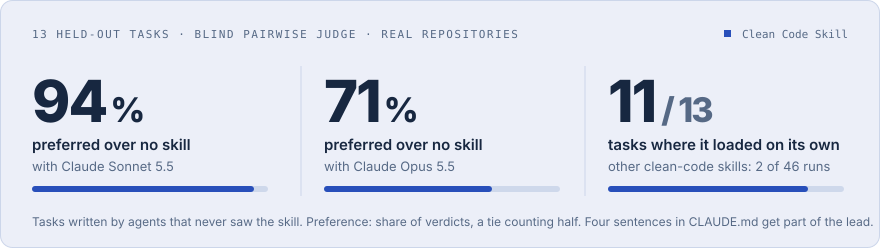
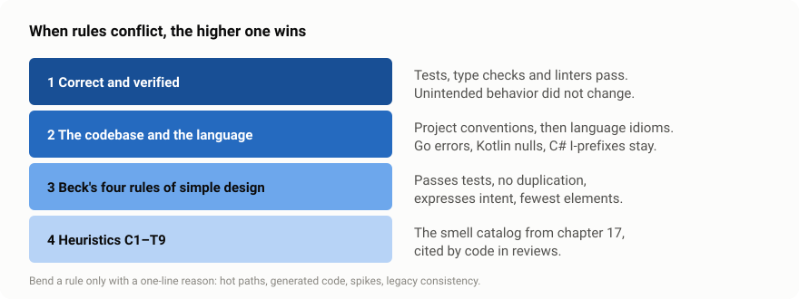
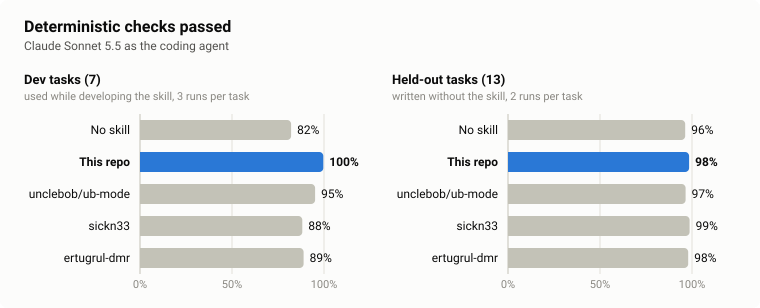
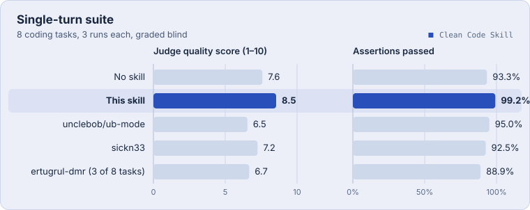

<p align="center">
  
</p>

<p align="center"><a href="README.md">English</a> · Deutsch</p>

**Clean Code Skill** ist ein [Agent Skill](https://agentskills.io), der Coding-Agents *Clean Code* nach Robert C. Martin beibringt, inklusive Becks vier Regeln des einfachen Designs und des vollständigen Smell-Katalogs C1–T9. Er passt das Buch an die Fehler an, die Agents tatsächlich machen.

Die meisten Clean-Code-Skills geben das Buch wieder. Dieser sagt dem Agent zusätzlich, **wann das Buch verliert**: wenn die Sprache ein anderes Idiom hat, wenn die Codebasis eine Konvention hat, wenn der Code ein Hot Path ist, oder wenn „Aufräumen“ bedeutet, Code anzufassen, nach dem niemand gefragt hat.

Der Skill selbst ist auf Englisch, damit er in jedem Agent und für jedes Team funktioniert. Der Agent antwortet trotzdem in deiner Sprache.

<p align="center">
  
</p>

## Was er anders macht

<p align="center">
  
</p>

1. **Eine Vorrangregel.** Korrektheit zuerst, dann Projektkonventionen und Sprachidiome, dann Becks Regeln, dann die Heuristiken. Jede gebogene Regel braucht eine einzeilige Begründung.
2. **Scope-Disziplin und typische Agent-Fehler.** Vor dem Schreiben suchen, Diff auf die Aufgabe begrenzen, keine spekulativen Abstraktionen oder Parameter, keine verschluckten Fehler, keine Kommentare, die die Änderung nacherzählen, kein ungeprüftes „Tests grün“. Ist die Aufgabe ein Aufräumen, gehört die ganze Einheit dazu.
3. **Ausdrückliche Ausnahmen.** Hot Paths, generierter Code, Wegwerf-Skripte, Konsistenz mit Legacy-Code, tiefe Module.
4. **Geprüfte Arbeit, ehrlich berichtet.** Ungetesteten Code vor dem Refactoring mit Charakterisierungstests festhalten, jeden Fix und jedes sichtbare Verhalten mit einem Test absichern, Typechecker und Tests entscheiden lassen, was sicher ist, das Design gegen die Zahlen der Aufgabe prüfen und am Ende nur berichten, was geprüft wurde.
5. **Eine Beschreibung, die ihn laden lässt.** Sie sagt dem Agent, den Skill vor dem ersten Edit jeder Coding-Aufgabe zu laden, damit er benutzt wird, ohne dass jemand danach fragt.

## Ergebnisse

Zwei Benchmarks vergleichen den Skill, wie er im Repository steht, mit „ohne Skill“ und mit drei anderen Clean-Code-Skills: [unclebob/ub-mode](https://github.com/unclebob/ub-mode) von Robert C. Martin, [sickn33/clean-code](https://github.com/sickn33/agentic-awesome-skills/tree/main/skills/clean-code) (der Clean-Code-Skill mit den meisten Installationen auf skills.sh, Stand November 2026) und [ertugrul-dmr/clean-code-skills](https://github.com/ertugrul-dmr/clean-code-skills) (nur Python und TypeScript). Der agentische Benchmark ist der wichtigere: Der Agent arbeitet mit echten Werkzeugen in einem echten Repository, und 13 der 20 Aufgaben blieben bei der Weiterentwicklung des Skills unter Verschluss.

### Agentischer Benchmark: echte Repositories, zurückgehaltene Aufgaben

Der Agent bekommt eine frische Kopie eines kleinen Repositories in Python, TypeScript, JavaScript, Java oder Rust und die üblichen Werkzeuge von Claude Code: lesen, suchen, editieren, Shell. Deterministische Checks bewerten, was er getan hat: versteckte Tests, geänderte Dateien, ob sein Regressionstest auf dem alten Code fehlschlägt, ob seine Tests eingebaute Fehler finden, ob er nach dem letzten Edit die Tests ausgeführt hat. Danach liest ein blinder Bewerter (Claude Opus 5.5) zwei Pull Requests zur selben Aufgabe, in beiden Reihenfolgen, und sagt, welchen er lieber mergen würde und welcher bei Korrektheit, Scope, Design, Lesbarkeit, Tests und Bericht besser ist. Jede der 13 zurückgehaltenen Aufgaben lief zweimal pro Modell und Bedingung.

<p align="center">
  
</p>

| Coding-Agent | gegen ohne Skill | gegen ub-mode | gegen sickn33 | gegen ertugrul-dmr (7 Aufgaben) | Kosten pro Lauf: ohne Skill → dieser Skill |
|---|---|---|---|---|---|
| Claude Sonnet 5.5 | 24 / 1 / 1 · 94 % | 26 / 0 / 0 · 100 % | 20 / 5 / 1 · 84 % | 9 / 4 / 1 · 79 % | 0,09 $ → 0,17 $ |
| Claude Opus 5.5 | 18 / 1 / 7 · 71 % | 19 / 4 / 3 · 81 % | 18 / 3 / 5 · 74 % | 7 / 3 / 4 · 59 %\* | 0,24 $ → 0,33 $ |
| Claude Haiku 5.5 | 13 / 2 / 11 · 54 %\* | 11 / 2 / 13 · 46 %\* | 14 / 6 / 6 · 63 % | 10 / 1 / 3 · 75 % | 0,010 $ → 0,015 $ |

Siege / Unentschieden / Niederlagen dieses Skills und die Präferenz des Bewerters für ihn, ein Unentschieden zählt halb. \* Das 95-%-Intervall schließt 50 % ein; das ist ein Trend, kein Ergebnis.

- **Mit Sonnet und Opus bevorzugt der Bewerter diesen Skill gegenüber jeder Alternative,** bis auf einen Vergleich mit Intervallen oberhalb von 50 %. Mit Sonnet ist der Vorsprung am größten: 24 von 26 Vergleichen gegen ohne Skill, alle 26 gegen ub-mode.
- **Mit Haiku hilft der Skill gegen ohne Skill und ub-mode nicht messbar;** gegen sickn33 und ertugrul-dmr gewinnt er trotzdem. Das kleine Modell setzt die zusätzlichen Regeln weniger zuverlässig um.
- **Der Vorsprung kommt vor allem aus Tests und Bericht, weniger aus dem Produktionscode.** Gegen ohne Skill gingen bei den Tests 93 % (Sonnet), 70 % (Opus) und 62 % (Haiku) der Urteile an diesen Skill, beim Bericht 78 %, 76 % und 61 %. Bei Korrektheit und Design liegen Opus und Haiku etwa gleichauf, mit Opus liest sich der Code ohne Skill sogar etwas besser (42 %); mit Sonnet gewinnt auch der Code (Lesbarkeit 78 %, Design 62 %).
- **Die Checks trennen auf den zurückgehaltenen Aufgaben kaum.** Dort bestehen alle Bedingungen 94–99 %, also entscheidet der Bewerter. Auf den Dev-Aufgaben, an denen der Skill verbessert wurde, trennen sie noch: ohne Skill 82 %, dieser Skill 100 %.
- **Der Skill kostet mehr.** Ein Lauf ist 35–82 % teurer als ohne Skill und braucht mehr Schritte (Sonnet: 12,8 statt 9,3), vor allem fürs Schreiben und Ausführen von Tests.

<p align="center">
  
</p>

#### Lädt sich ein Skill von selbst?

Oben steht der Skill im System-Prompt. Im echten Einsatz liegt er neben dem Code, und der Agent entscheidet, ob er ihn lädt. Claude Sonnet 5.5, zurückgehaltene Aufgaben, je ein Lauf:

| Als Projekt-Skill installiert … | Dieser Skill | ub-mode | sickn33 | ertugrul-dmr |
|---|---|---|---|---|
| und nirgends erwähnt | **11 / 13** | 0 / 13 | 0 / 13 | 1 / 7 |
| mit einer Zeile in `CLAUDE.md` ([unten](#nutzung)) | 13 / 13 | 13 / 13 | 13 / 13 | 7 / 7 |

Dieser Skill hat sich bei jeder Aufgabe selbst geladen außer beim PR-Review, bei dem nichts editiert wird, und bei einer Performance-Aufgabe. ub-mode ist dafür gedacht, mit `/ub-mode` eingeschaltet zu werden, und soll sich gar nicht selbst laden. Mit der einen Zeile in `CLAUDE.md` lud sich jeder Skill in jedem Lauf. Bei fünf Aufgaben ohne Code (Gedicht, E-Mail, Frage zu TCP, README zusammenfassen, Regex erklären) lud sich dieser Skill nie.

13 Aufgaben mit zwei Läufen pro Zelle sind wenig, und die Intervalle beschreiben diese Aufgaben, nicht Aufgaben im Allgemeinen. Der Bewerter ist Claude Opus, das auch ein Drittel des Codes geschrieben hat; er weiß nicht, welcher Skill welchen Pull Request geschrieben hat, könnte aber Code bevorzugen, der wie sein eigener aussieht. ub-mode wurde ohne seine Begleit-Tools gemessen. Nach den finalen Läufen stellte sich heraus, dass ein Check Commit-Nachrichten als Dateizugriffe las; das traf nur ub-mode, den einzigen Skill, der den Agent committen lässt. Der Check wurde korrigiert und jeder Lauf neu bewertet. Alle Grenzen stehen in [`evals/README.md`](evals/README.md#limits).

### Single-Turn-Suite

Acht realistische Coding-Aufgaben in Python, TypeScript, Java, Go, Kotlin, C# und JavaScript, je eine Antwort ohne Werkzeuge, je dreimal pro Bedingung. Claude Sonnet 5.5 schreibt den Code, Claude Opus 5.5 bewertet alle Antworten einer Aufgabe gemeinsam unter vertauschten Bezeichnungen.

<p align="center">
  
</p>

- **Ein starkes Modell kann das schon gut.** Ohne Skill erfüllt Sonnet 93,3 % der Kriterien. Ein Clean-Code-Skill kann wenig gewinnen und einiges verschlechtern.
- **Ein Skill kann schaden.** sickn33/clean-code fällt beim Hot Path auf 60 %, unter ohne Skill: Der Bit-Test wandert in eine Hilfsmethode innerhalb der Paket-Schleife, und die vage Exception bleibt. ertugrul-dmr fällt beim PR-Review auf 80 %, wo ohne Skill alles erfüllt.
- **Dieser Skill erfüllt in jeder Aufgabe mindestens so viele Kriterien wie ohne Skill** und hebt das durchschnittliche Qualitätsurteil von 7,6 auf 8,5. Sein einziger Fehler: ein nicht verlangter `currency`-Parameter in einem von drei Läufen.

Das ist eine Plausibilitätsprüfung, keine Rangliste: acht Fälle, die auch zur Verbesserung des Skills dienten, und ein KI-Bewerter, der die Antworten so sieht, wie sie geschrieben sind. Methode, Grenzen und alle Rohdaten: [`evals/README.md`](evals/README.md).

## Installation

```bash
npx skills add jonax1337/clean-code-skill
```

In Claude Code alternativ als Plugin:

```text
/plugin marketplace add jonax1337/clean-code-skill
/plugin install clean-code@clean-code-skill
```

Oder manuell `skills/clean-code` nach `~/.claude/skills/` kopieren.

## Nutzung

Der Skill lädt sich von selbst, sobald der Agent Code schreibt, ändert, korrigiert, refaktoriert oder testet, und bleibt bei Aufgaben ohne Code draußen. Direkt aufrufen geht mit `/clean-code <pfad>`, als Claude-Code-Plugin mit `/clean-code:clean-code <pfad>`. Soll er sicher immer gelten, auch bei Reviews, genügt eine Zeile in `CLAUDE.md` oder `AGENTS.md`; im Test oben lud sich damit jeder Skill in jedem Lauf:

```markdown
Before writing, changing or reviewing code, load the clean-code skill and follow it.
```

## Hinweis

Logo, Farbpalette und Gestaltungsregeln: [Focus-Branding](docs/branding/README.md).

Basiert auf *Clean Code* von Robert C. Martin (2008) und Kent Becks Regeln des einfachen Designs. Das Projekt ist weder mit den Autoren verbunden noch von ihnen autorisiert. Der Skill gibt die Ideen sinngemäß wieder; die Begründungen stehen im Buch.

Lizenz: [MIT](LICENSE)
