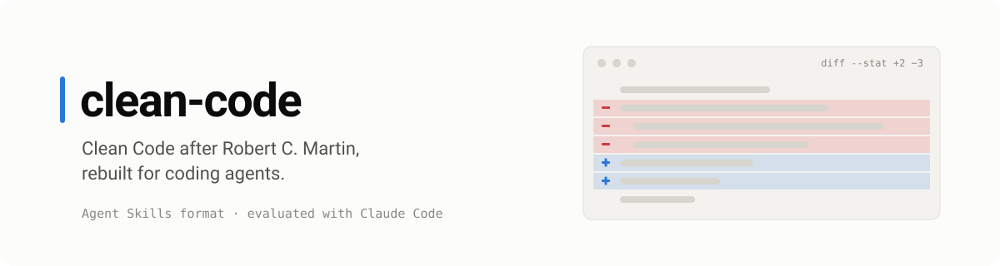
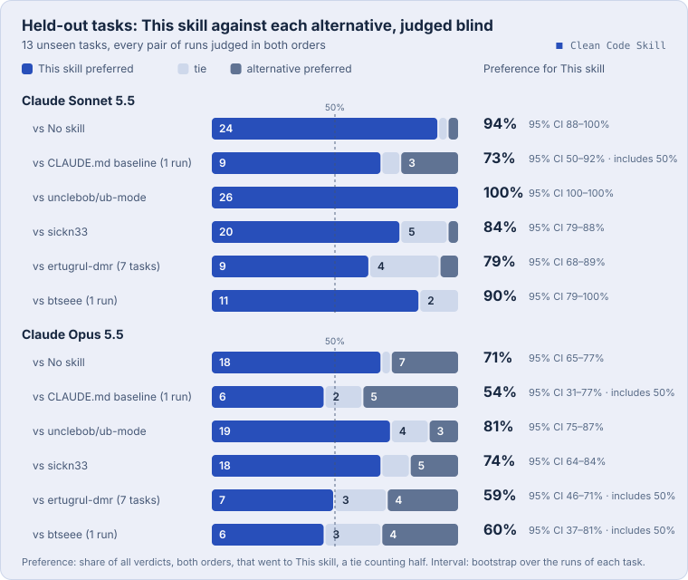
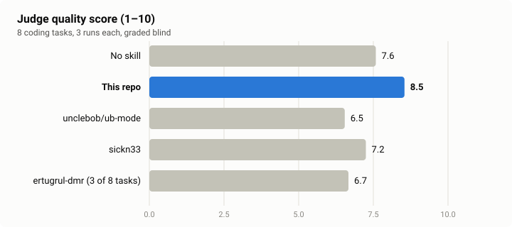
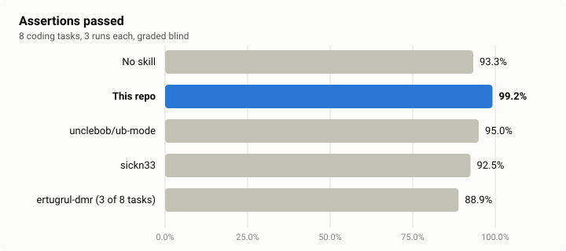
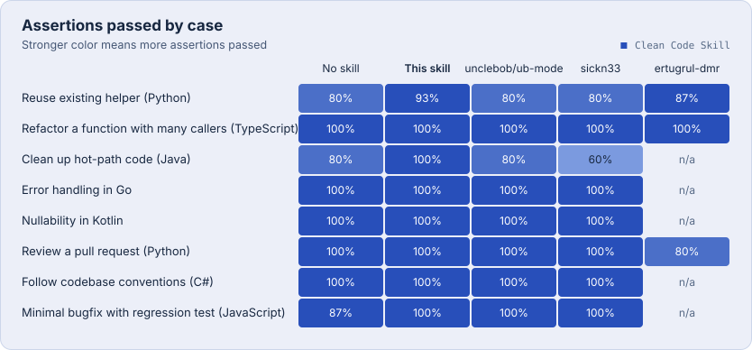
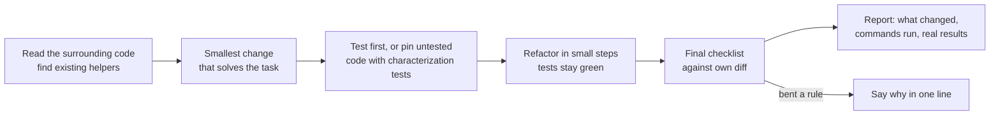

<p align="center">
  
</p>

<p align="center">
  <a href="LICENSE"></a>
  <a href="https://agentskills.io"></a>
  <a href="evals/README.md"></a>
  <a href="README.de.md"></a>
</p>

An [Agent Skill](https://agentskills.io) that teaches coding agents *Clean Code* (Robert C. Martin), including Beck's four rules of simple design and the full C1–T9 smell catalog, and adapts it to how agents actually fail.

Most clean-code skills restate the book. This one also tells the agent **when the book loses**: when the language has a different idiom, when the codebase has a convention, when the code is a hot path, or when "cleaning up" means touching code nobody asked about.

## Why another clean-code skill

An agent that applies the book literally makes predictable mistakes. In the eval runs below:

- the first version of this skill replaced idiomatic Kotlin `String?` with an exception in all three runs, because "don't return null";
- with a book-summary skill loaded, the agent moved bit tests on a per-packet hot path into helper methods, because "functions should be small";
- with book-based skills loaded, a two-line bugfix grew into a refactoring of code the bug did not touch;
- without any skill, the agent added a `currency` parameter nobody asked for in all three runs;
- with v2 of this skill, an agent asked to refactor untested TypeScript left its `any` types in place and wrote no tests to pin the old behavior first, in all three runs.

This skill addresses these with four additions on top of the book:

<p align="center">
  
</p>

1. **A precedence order.** Correctness first, then the codebase's conventions and the language's idioms, then Beck's rules, then the heuristics. Every bent rule needs a one-line reason.
2. **Scope discipline and agent failure modes.** Search before writing, keep the diff to the task, no speculative abstractions, no swallowed errors, no narrating comments, no unverified "tests pass". When the task *is* a cleanup, the whole unit is in scope.
3. **Explicit exceptions.** Hot paths, generated code, throwaway scripts, legacy consistency, deep modules.
4. **Verified work, reported accurately.** Pin untested code with characterization tests before refactoring it, cover every fix with a test, let the type checker and the tests decide what is safe, and end with a report that claims only what was checked.

## Results

Two benchmarks. The agentic one is the main evidence: the agent works in a real repository with real tools, and six of its nine tasks were held out while the skill was written.

### Agentic track: real repositories, held-out tasks

The coding agent gets a fresh copy of a small repository in Python, TypeScript or Rust and the tools Claude Code normally has: read, search, edit and a shell. Deterministic checks grade what it did: hidden tests, which files changed, whether its regression test fails on the old code, whether it ran the tests after its last edit. A blind judge (Claude Opus 5.5) then reads two pull requests for the same task, once in each order, and says which one it would rather merge.

Three tasks were used while writing v3. The other six were written by separate agents that never saw the skill, and v3 had to beat v2 on those.

<p align="center">
  
</p>

| Coding agent | v3 wins / ties / v2 wins | Preference for v3 [95% CI] | Checks passed: no skill / v2 / v3 | Avg. cost per run with v3 |
|---|---|---|---|---|
| Claude Sonnet 5.5 | 12 / 4 / 2 | 78% [67–89%] | 97% / 100% / 100% | $0.10 |
| Claude Opus 5.5 | 9 / 6 / 3 | 68% [58–79%] | 98% / 98% / 99% | $0.25 |
| Claude Haiku 5.5 | 10 / 2 / 6 | 62% [49–76%] | 98% / 97% / 97% | $0.009 |

What the numbers say:

- **On held-out tasks the judge prefers v3 over v2** with Sonnet and Opus, and both intervals stay above 50%. With Haiku the direction is the same, but the interval includes 50%, so that one is a trend, not a result.
- **The production code is often the same; the tests are not.** In the judge's stated reasons, v3's pull requests win mostly on their tests (behavior pinned before a refactor, regression tests with edge cases) and on tighter types, not on longer reports.
- **The checks no longer separate the skills on held-out tasks.** Every condition passes 97–100% of them there, so the judge decides. On the dev tasks they still did: without a skill the agent never ran the tests after its last edit and added no regression test for the bugfix; v2 fixed both, and v3 also pinned untested code with characterization tests before refactoring it.

<p align="center">
  
</p>

Nine tasks with three runs per cell are a small sample, and the intervals describe these tasks, not tasks in general. The skill was appended to the system prompt rather than triggered, so whether it loads on its own is not tested. The first grading of the held-out runs had false alarms (Windows line endings, a CLI's intended `print`, Rust unit tests) that put v3 slightly behind v2; they were fixed for every condition and all runs regraded before these numbers. Transcripts, diffs, checks with evidence and every verdict with its reasons are under [`evals/results/agentic/`](evals/results/agentic).

### Single-turn suite (measured with v2)

The first benchmark asks for one reply without tools. Eight realistic coding tasks across Python, TypeScript, Java, Go, Kotlin, C# and JavaScript, each run three times under four conditions: no skill, [sickn33/clean-code](https://github.com/sickn33/agentic-awesome-skills/tree/main/skills/clean-code) (the clean-code skill with the most installs on skills.sh as of November 2026), the first version of this skill, and v2. Claude Sonnet 5.5 wrote the code; Claude Opus 5.5 graded all four answers to each task under shuffled labels. v3 keeps every rule of v2 and adds the ones above; it has not been rerun on this suite.

<p align="center">
  
  
</p>

| Condition | Assertions passed | Judge quality (1–10) | Avg. cost per task |
|---|---|---|---|
| No skill | 95.8% | 7.5 | $0.013 |
| sickn33/clean-code | 92.5% | 7.5 | $0.018 |
| This repo, v1 | 89.2% | 6.2 | $0.019 |
| **This repo, v2** | **99.2%** | **8.4** | $0.017 |

What the numbers say:

- **A strong model is already good at this.** Without any skill, Sonnet passed 95.8% of the assertions. A clean-code skill has little room to help and plenty of room to hurt.
- **A skill can make things worse.** sickn33/clean-code dropped to 60% on the hot-path task: it moved bit tests into helper methods inside the per-packet loop and left the vague exception unchanged. This repo's own first version dropped to 60% on Kotlin by replacing `String?` with an exception. Both scored below no skill at all on those tasks.
- **v2 passed at least as many assertions as no skill on every task** and raised the average quality score from 7.5 to 8.4. Its quality score was slightly lower than no skill on one task (the PR review, 8.0 vs 8.3). The gains come mostly from scope discipline (no unrequested parameters, minimal bugfixes) and from knowing when not to apply a rule.

<p align="center">
  
</p>

Treat these as a sanity check, not a leaderboard: eight cases, an LLM judge that can partly tell skill-guided answers apart (they cite heuristic codes), and cases written alongside v2. Every reply and every verdict with its evidence is committed under [`evals/results/`](evals/results), and [`evals/README.md`](evals/README.md) explains both benchmarks and how to rerun them.

## Install

The skill uses the open [Agent Skills](https://agentskills.io) format, so any client that supports it can load it. The evals ran with Claude Code only.

**Via [skills.sh](https://skills.sh)** (installs into Claude Code, Codex, Cursor and other supported agents):

```bash
npx skills add jonax1337/clean-code-skill
```

**Claude Code plugin marketplace:**

```text
/plugin marketplace add jonax1337/clean-code-skill
/plugin install clean-code@clean-code-skill
```

**Manually:** copy `skills/clean-code` into your skills folder, for Claude Code `~/.claude/skills/` (personal) or `.claude/skills/` (per project).

```bash
git clone https://github.com/jonax1337/clean-code-skill
cp -r clean-code-skill/skills/clean-code ~/.claude/skills/
```

## Usage

The skill triggers on its own whenever the agent writes, changes, refactors, fixes or reviews code. You can also call it directly:

```text
/clean-code src/billing/invoice.py      refactor a file or folder, behavior preserved
review this diff with /clean-code       findings ordered by impact, with C1–T9 codes
```

Installed as a Claude Code plugin, the skill is namespaced: use `/clean-code:clean-code` instead of `/clean-code`.

If you want it applied every time without relying on triggering, add one line to your `CLAUDE.md` or `AGENTS.md`:

```markdown
Before writing, changing or reviewing code, load the clean-code skill and follow it.
```

## How it works



```text
skills/clean-code/
├── SKILL.md                      precedence, rules by chapter, exceptions, agent failure modes, checklist
└── references/
    ├── heuristics.md             the full C1–T9 catalog with symptoms and fixes
    ├── language-idioms.md        how the book's rules translate to Go, Rust, Kotlin, TS, Python, C#
    ├── agent-pitfalls.md         nine failure modes of coding agents, with what to do instead
    └── examples.md               before/after pairs, including where the book bends
```

`SKILL.md` stays under 200 lines so it is cheap to load on every coding task. The references are read only when needed.

## Other clean-code skills

Several good skills cover the same book with different goals (descriptions as of November 2026):

| Skill | Approach |
|---|---|
| [sickn33/agentic-awesome-skills → clean-code](https://github.com/sickn33/agentic-awesome-skills/tree/main/skills/clean-code) | Compact summary of the book in one file, with a note to follow repository conventions |
| [hatlesswizard/clean-code-skills](https://github.com/hatlesswizard/clean-code-skills) | 18 skills, one checker per book chapter, plus an orchestrator |
| [nghorbani/clean-code-skill](https://github.com/nghorbani/clean-code-skill) | On-demand knowledge base with glossary, patterns and the G1–G36 heuristics |
| [markoa/clean-code-skill](https://github.com/markoa/clean-code-skill) | A short, mandatory operating contract of 14 rules |
| **this repo** | Book plus precedence, agent failure modes and explicit exceptions, measured with published evals |

Pick by what you need: a reference to look things up, a per-chapter checker, or a set of working rules for an agent that edits real codebases.

## Contributing

Issues and pull requests are welcome, especially new eval cases. A good case is a realistic task where a naive reading of the book produces a worse result. Add it to [`evals/cases/`](evals/cases) for a single reply, or to [`evals/cases-agentic/`](evals/cases-agentic) as a small repository with hidden tests, checks and a reference solution that `selftest_agentic.py` accepts. Rerun the evals and include the summary in the pull request.

## Credits

Based on *Clean Code: A Handbook of Agile Software Craftsmanship* by Robert C. Martin (Prentice Hall, 2008), and on Kent Beck's rules of simple design. This project is not affiliated with or endorsed by the authors. The skill paraphrases the ideas; for the reasoning and the examples behind them, read the book.

## License

[MIT](LICENSE)
