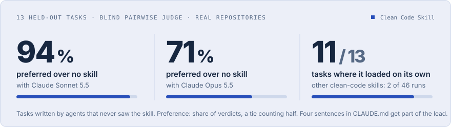
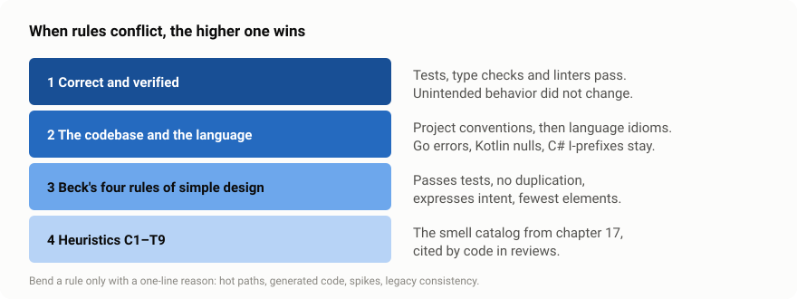
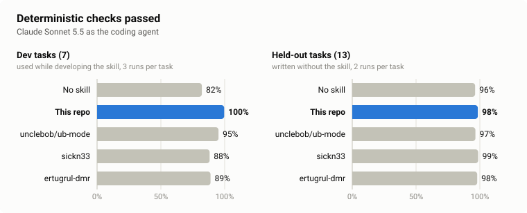
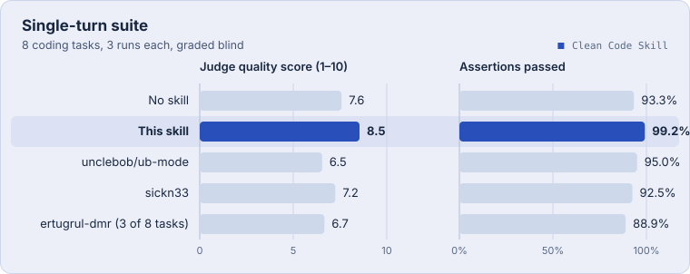
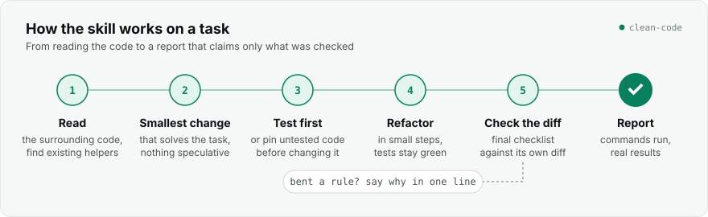

<p align="center">
  
</p>

<p align="center">
  <a href="LICENSE"></a>
  <a href="https://agentskills.io"></a>
  <a href="evals/README.md"></a>
  <a href="README.de.md"></a>
</p>

**Clean Code Skill** is an [Agent Skill](https://agentskills.io) that teaches coding agents *Clean Code* (Robert C. Martin), including Beck's four rules of simple design and the full C1–T9 smell catalog, and adapts it to how agents actually fail.

Most clean-code skills restate the book. This one also tells the agent **when the book loses**: when the language has a different idiom, when the codebase has a convention, when the code is a hot path, or when "cleaning up" means touching code nobody asked about.

<p align="center">
  
</p>

## Why another clean-code skill

An agent that applies the book literally, or does not get it at all, makes predictable mistakes. In the eval runs below:

- without a skill, and with ub-mode or sickn33 loaded, the agent added a `currency` parameter nobody asked for, in all three runs;
- with a book-summary skill loaded, the agent pulled the bit test of a per-packet hot loop into a helper method in all three runs, because "functions should be small", and left the vague exception as it was;
- without a skill, the agent added a feature with no test and never ran the tests after its last edit, and fixed a bug without a regression test, in all three runs;
- installed next to the code and never mentioned, the other clean-code skills loaded on their own in 2 of 46 runs, so in practice they were not used at all.

This skill addresses these with five additions on top of the book:

<p align="center">
  
</p>

1. **A precedence order.** Correctness first, then the codebase's conventions and the language's idioms, then Beck's rules, then the heuristics. Every bent rule needs a one-line reason.
2. **Scope discipline and agent failure modes.** Search before writing, keep the diff to the task, no speculative abstractions or parameters, no swallowed errors, no narrating comments, no unverified "tests pass". When the task *is* a cleanup, the whole unit is in scope.
3. **Explicit exceptions.** Hot paths, generated code, throwaway scripts, legacy consistency, deep modules.
4. **Verified work, reported accurately.** Pin untested code with characterization tests before refactoring it, cover every fix and every visible behavior with a test, let the type checker and the tests decide what is safe, check the design against the numbers the task states, and end with a report that claims only what was checked.
5. **A description that makes it load.** It tells the agent to load the skill before its first edit on any coding task, so it is used without anyone asking for it.

## Results

Two benchmarks compare this skill as it is in the repository with no skill and with four other clean-code skills: [unclebob/ub-mode](https://github.com/unclebob/ub-mode) by Robert C. Martin, [sickn33/clean-code](https://github.com/sickn33/agentic-awesome-skills/tree/main/skills/clean-code) (the clean-code skill with the most installs on skills.sh as of November 2026), [ertugrul-dmr/clean-code-skills](https://github.com/ertugrul-dmr/clean-code-skills) (Python and TypeScript only) and [btseee/clean-code-skills](https://github.com/btseee/clean-code-skills). The agentic one also has a cheap baseline without any skill: four sentences in `CLAUDE.md` that ask for exactly the habits the skill's lead comes from (a scoped diff, tests, a test run at the end, an honest report). The agentic track is the main evidence: the agent works in a real repository with real tools, and 13 of its 20 tasks were held out while the skill was improved.

### Agentic track: real repositories, held-out tasks

The coding agent gets a fresh copy of a small repository in Python, TypeScript, JavaScript, Java or Rust and the tools Claude Code normally has: read, search, edit and a shell. Deterministic checks grade what it did: hidden tests, which files changed, whether its regression test fails on the old code, whether its tests catch planted bugs, whether it ran the tests after its last edit. A blind judge (Claude Opus 5.5) then reads two pull requests for the same task, once in each order, and says which one it would rather merge and which one is better on correctness, scope, design, readability, tests and the report.

The 13 held-out tasks were written by separate agents that never saw the skill. Each ran twice per coding agent and condition (the `CLAUDE.md` baseline and btseee, added later, once), and every pull request written with this skill was compared with the one written without a skill and with each alternative on the same task. The skill was frozen at commit `c10f424` for the later additions.

<p align="center">
  
</p>

| Coding agent | vs no skill | vs `CLAUDE.md` baseline (1 run) | vs ub-mode | vs sickn33 | vs ertugrul-dmr (7 tasks) | vs btseee (1 run) | Avg. cost per run: no skill → baseline → this skill |
|---|---|---|---|---|---|---|---|
| Claude Sonnet 5.5 | 24 / 1 / 1 · 94% | 9 / 1 / 3 · 73%\* | 26 / 0 / 0 · 100% | 20 / 5 / 1 · 84% | 9 / 4 / 1 · 79% | 11 / 2 / 0 · 90% | $0.09 → $0.11 → $0.17 |
| Claude Opus 5.5 | 18 / 1 / 7 · 71% | 6 / 2 / 5 · 54%\* | 19 / 4 / 3 · 81% | 18 / 3 / 5 · 74% | 7 / 3 / 4 · 59%\* | 6 / 3 / 4 · 60%\* | $0.24 → $0.26 → $0.33 |

Wins / ties / losses for this skill and the judge's preference for it, a tie counting half. \* The 95% interval includes 50%, so that comparison is a trend, not a result. The baseline and btseee ran once per task; their intervals resample the tasks and are about twice as wide (Sonnet against the baseline: 50–92%).

What the numbers say:

- **Four sentences in `CLAUDE.md` get a large part of the lead.** Against no skill, the baseline alone won 9 of 13 comparisons with Sonnet (69%), almost all of it through the tests. The skill still beats the baseline with Sonnet in 9 of 13 tasks; with Opus the two come out even (54%). Read the skill's large lead over no skill as "habits plus clean-code rules", not as clean-code rules alone.
- **What the skill adds on top of the baseline is model-dependent.** Share of the judge's per-dimension verdicts that went to this skill:

  | Dimension | Sonnet vs no skill | Sonnet vs baseline | Opus vs no skill | Opus vs baseline | Baseline vs no skill (Sonnet) |
  |---|---|---|---|---|---|
  | Tests | 93% | 54% | 70% | 48% | 88% |
  | Report | 78% | 60% | 76% | 71% | 58% |
  | Readability | 78% | 75% | 42% | 48% | 62% |
  | Design | 62% | 62% | 52% | 44% | 56% |
  | Correctness | 57% | 63% | 53% | 44% | 38% |
  | Scope | 49% | 54% | 54% | 52% | 50% |

  The baseline buys the tests. With Sonnet, the skill's remaining edge over the baseline is readability, design and correctness, so the clean-code part does show up in the code. With Opus it is only the report; correctness and design come out about even or slightly behind the baseline.
- **A judge from another model family sees the same direction.** GPT 6.1 Sol re-judged every Sonnet comparison against no skill and against the baseline, blind and in both orders. It preferred this skill in 21 of 26 comparisons against no skill (81%, Opus: 94%) and in 10 of 13 against the baseline (77%, Opus: 73%). The two judges picked the same side in 77% of the 39 comparisons and agree well on tests, correctness and scope, but not on readability and the report (56% and 49% the same side). The skill's readability lead is mostly Opus's view; GPT calls the reports about even. Details: [`evals/results/agentic/judge-agreement.md`](evals/results/agentic/judge-agreement.md).
- **The checks barely separate the conditions on held-out tasks.** Every condition passes 94–99% of them there, so the judge decides. On the dev tasks, where the skill was tuned, they still do: no skill 82%, the baseline 93%, this skill 100%.
- **The skill costs more.** A run with it costs 35–82% more than without a skill and takes more turns (Sonnet: 12.8 instead of 9.3), mostly for writing and running tests. The baseline costs 5–20% more than no skill.

<p align="center">
  
</p>

#### Does a skill load on its own?

The runs above put the skill into the system prompt. In real use it is installed next to the code, and the agent decides whether to load it. Claude Sonnet 5.5, held-out tasks, one run each:

| Installed as a project skill … | This skill | ub-mode | sickn33 | ertugrul-dmr | btseee |
|---|---|---|---|---|---|
| and nothing mentions it | **11 / 13** | 0 / 13 | 0 / 13 | 1 / 7 | 1 / 13 |
| with one line in `CLAUDE.md` ([below](#usage)) | 13 / 13 | 13 / 13 | 13 / 13 | 7 / 7 | 13 / 13 |

This skill loaded itself on every task except the pull-request review, where nothing is edited, and a performance task. ub-mode is meant to be switched on with `/ub-mode`, so it is not expected to load on its own; btseee says agents pick it up by themselves, but it loaded on one task, the tokenizer cleanup. With the one line in `CLAUDE.md`, every skill loaded in every run. On five tasks without code (a poem, an email, a question about TCP, a README summary, a regex explanation) this skill never loaded.

Thirteen tasks with two runs per cell (one for the baseline and btseee) are a small sample, and the intervals describe these tasks, not tasks in general. Only Claude models wrote the code. The main judge is Claude Opus, which also wrote half of the code reported here; it does not know which skill wrote which pull request but may prefer code that reads like its own, which is why GPT 6.1 Sol re-judged the Sonnet comparisons. ub-mode was measured without its companion tools, btseee without running its one-time `init` (see [`evals/README.md`](evals/README.md#conditions)). After the final runs, one check turned out to misread commit messages as file writes, which only hurt ub-mode (the only skill that makes the agent commit); it was fixed and every run regraded. [`evals/README.md`](evals/README.md#limits) lists these limits in full; transcripts, diffs, checks with evidence and every verdict with its reasons are under [`evals/results/agentic/`](evals/results/agentic).

### Single-turn suite

The second benchmark asks for one reply without tools. Eight realistic coding tasks across Python, TypeScript, Java, Go, Kotlin, C# and JavaScript, each run three times per condition. Claude Sonnet 5.5 wrote the code; Claude Opus 5.5 graded all answers to each task at once under shuffled labels. The `CLAUDE.md` baseline and btseee were added later and run in the agentic track only: this judge grades all conditions of a task in one call, so adding a condition here would have changed every number below.

<p align="center">
  
</p>

| Condition | Assertions passed | Judge quality (1–10) | Avg. cost per task |
|---|---|---|---|
| No skill | 93.3% | 7.6 | $0.012 |
| **This skill** | **99.2%** | **8.5** | $0.022 |
| unclebob/ub-mode | 95.0% | 6.5 | $0.023 |
| sickn33/clean-code | 92.5% | 7.2 | $0.018 |
| ertugrul-dmr/clean-code (3 of 8 tasks) | 88.9% | 6.7 | $0.022 |

What the numbers say:

- **A strong model is already good at this.** Without any skill, Sonnet passed 93.3% of the assertions. A clean-code skill has little room to help and plenty of room to hurt.
- **A skill can make things worse.** sickn33/clean-code dropped to 60% on the hot-path task, below no skill, and ertugrul-dmr to 80% on the pull-request review, where no skill passed everything. ub-mode passed more assertions than no skill but got the lowest quality score.
- **This skill passed at least as many assertions as no skill on every task** and raised the average quality score from 7.6 to 8.5. Its one miss: an unrequested `currency` parameter in one of three runs.

<p align="center">
  
</p>

Treat these as a sanity check, not a leaderboard: eight cases that were also used to improve the skill, and an LLM judge that sees the answers as written. Every reply and every verdict with its evidence is committed under [`evals/results/`](evals/results), and [`evals/README.md`](evals/README.md) explains both benchmarks and how to rerun them.

## Install

The skill uses the open [Agent Skills](https://agentskills.io) format, so any client that supports it can load it. The evals ran with Claude Code only.

**Via [skills.sh](https://skills.sh)** (installs into Claude Code, Codex, Cursor and other supported agents):

```bash
npx skills add jonax1337/clean-code-skill
```

**Claude Code plugin marketplace:**

```text
/plugin marketplace add jonax1337/clean-code-skill
/plugin install clean-code@clean-code-skill
```

**Manually:** copy `skills/clean-code` into your skills folder, for Claude Code `~/.claude/skills/` (personal) or `.claude/skills/` (per project).

```bash
git clone https://github.com/jonax1337/clean-code-skill
cp -r clean-code-skill/skills/clean-code ~/.claude/skills/
```

## Usage

The skill's description tells the agent to load it before its first edit, so it loads on its own whenever the agent writes, changes, fixes, refactors or tests code, and stays out of tasks without code. You can also call it directly:

```text
/clean-code src/billing/invoice.py      refactor a file or folder, behavior preserved
review this diff with /clean-code       findings ordered by impact, must-fix apart from suggestions
```

Installed as a Claude Code plugin, the skill is namespaced: use `/clean-code:clean-code` instead of `/clean-code`.

To make loading certain, for this skill or any other, add one line to your `CLAUDE.md` or `AGENTS.md`. In the trigger test above it made every measured skill load in every run, reviews included:

```markdown
Before writing, changing or reviewing code, load the clean-code skill and follow it.
```

## How it works

<p align="center">
  
</p>

```text
skills/clean-code/
├── SKILL.md                      precedence, rules by chapter, exceptions, agent failure modes, checklist
└── references/
    ├── heuristics.md             the full C1–T9 catalog with symptoms and fixes
    ├── language-idioms.md        how the book's rules translate to Go, Rust, Kotlin, TS, Python, C#
    ├── agent-pitfalls.md         nine failure modes of coding agents, with what to do instead
    └── examples.md               before/after pairs, including where the book bends
```

`SKILL.md` stays under 200 lines so it is cheap to load on every coding task. The references are read only when needed.

## Other clean-code skills

Several good skills cover the same book with different goals (descriptions as of November 2026; the measured ones at the commits pinned in [`evals/harness.py`](evals/harness.py)):

| Skill | Approach | Measured here |
|---|---|---|
| [unclebob/ub-mode](https://github.com/unclebob/ub-mode) | Robert C. Martin's own short skill: make it work, make it right, follow practice. Meant to be switched on with `/ub-mode`; its companion tools (crapper, dryer, mutator) are installed separately | yes, the skill file without the tools |
| [sickn33/agentic-awesome-skills → clean-code](https://github.com/sickn33/agentic-awesome-skills/tree/main/skills/clean-code) | Compact summary of the book in one file, with a note to follow repository conventions | yes |
| [ertugrul-dmr/clean-code-skills](https://github.com/ertugrul-dmr/clean-code-skills) | One main skill per language (Python, TypeScript) plus six topic skills: names, functions, comments, tests, general rules, boy scout | yes, on the Python and TypeScript tasks |
| [btseee/clean-code-skills](https://github.com/btseee/clean-code-skills) | One skill for clean code and clean architecture with packs for 21 languages and 27 frameworks, scripts that map the project structure and check layer boundaries, and commands for `init`, `audit`, `clean-up`, `plan` and `review` that keep project memory in `.clean/` | yes, the whole skill folder in plain sessions, without `init` (agentic track only) |
| [hatlesswizard/clean-code-skills](https://github.com/hatlesswizard/clean-code-skills) | 18 skills, one checker per book chapter, plus an orchestrator | no |
| [nghorbani/clean-code-skill](https://github.com/nghorbani/clean-code-skill) | On-demand knowledge base with glossary, patterns and the G1–G36 heuristics | no |
| [markoa/clean-code-skill](https://github.com/markoa/clean-code-skill) | A short, mandatory operating contract of 14 rules | no |
| **this repo** | Book plus precedence, scope discipline, agent failure modes and explicit exceptions, with a description that makes the agent load it before the first edit | yes |

Pick by what you need: a reference to look things up, a per-chapter checker, or a set of working rules for an agent that edits real codebases.

## Contributing

Issues and pull requests are welcome, especially new eval cases. A good case is a realistic task where a naive reading of the book produces a worse result. Add it to [`evals/cases/`](evals/cases) for a single reply, or to [`evals/cases-agentic/`](evals/cases-agentic) as a small repository with hidden tests, checks and a reference solution that `selftest_agentic.py` accepts. Rerun the evals and include the summary in the pull request.

## Credits

Logo, palette and visual guidelines: [Focus identity](docs/branding/README.md).

Based on *Clean Code: A Handbook of Agile Software Craftsmanship* by Robert C. Martin (Prentice Hall, 2008), and on Kent Beck's rules of simple design. This project is not affiliated with or endorsed by the authors. The skill paraphrases the ideas; for the reasoning and the examples behind them, read the book.

## License

[MIT](LICENSE)
