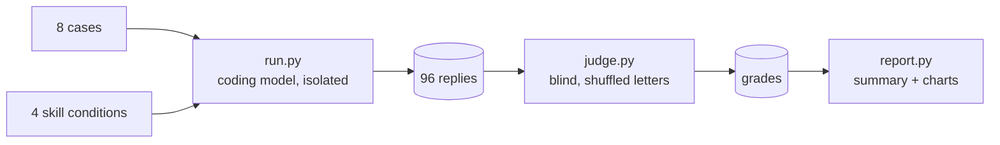

# Evals

A small, reproducible benchmark that checks whether a clean-code skill makes a coding agent produce better changes, and whether it avoids the ways "clean code" advice goes wrong in practice.

## What is measured

Eight coding tasks in [`cases/`](cases). Each has a realistic prompt and five pass/fail assertions. Five of the eight, marked with ●, target situations where applying the book literally makes the result worse:

| Case | What it checks |
|---|---|
| ● Reuse existing helper (Python) | Searches before writing, keeps the diff in scope |
| ● Refactor a function with many callers (TypeScript) | Preserves behavior and the public signature, names magic numbers, no over-engineering |
| ● Clean up hot-path code (Java) | Readability without allocations, virtual calls or helper splitting in a hot loop |
| ● Error handling in Go | Idiomatic `error` values instead of exception-style patterns |
| ● Nullability in Kotlin | Keeps `T?` instead of forcing "never return null" |
| Review a pull request (Python) | Finds the real bugs first, orders findings by impact |
| Follow codebase conventions (C#) | Keeps the `I` prefix and existing patterns |
| Minimal bugfix with regression test (JavaScript) | Root-cause fix, test, minimal diff |

## Conditions

| Name | Skill text in the system prompt |
|---|---|
| `baseline` | none |
| `sickn33` | [`sickn33/agentic-awesome-skills` → `skills/clean-code/SKILL.md`](https://github.com/sickn33/agentic-awesome-skills/blob/bbfc66fe61e8b6ced7d38481c47600e8ac9b8eea/skills/clean-code/SKILL.md), pinned to a commit; the most installed clean-code skill on skills.sh |
| `v1` | the first, German version of this skill ([`skills/v1.md`](skills/v1.md); stored without the `SKILL.md` name so installers do not pick it up) |
| `v2` | the current skill ([`../skills/clean-code/SKILL.md`](../skills/clean-code/SKILL.md)) |

Only `SKILL.md` is injected, never the reference files. That holds every condition to the same budget and is conservative for this repo, whose references carry extra material.

## How it runs



- **Isolation.** Each reply comes from a fresh `claude -p` process in an empty temp directory with no tools, no MCP servers, no slash commands, no user or local settings and `CLAUDE_CODE_DISABLE_CLAUDE_MDS=1`, so the user's own setup cannot leak in.
- **Models.** The published run used the aliases `sonnet` (coding) and `opus` (judge), which resolved to `claude-sonnet-5-5` and `claude-opus-5-5` on 2026-11-02. New runs record the exact model IDs in each `runs/*.json`.
- **Blind grading.** For each case and repetition, one judge call sees all four replies under shuffled letters (`A`–`D`) and grades every assertion plus an overall 1–10 quality score. The mapping back to conditions is stored in the grade file.
- **Repetitions.** Three runs per case and condition, because single runs of a language model are noisy.

## Reproduce

Requires Python 3.10+ and a logged-in [Claude Code](https://docs.claude.com/en/docs/claude-code) CLI.

```bash
python evals/run.py --reps 3 --model sonnet   # 96 coding runs
python evals/judge.py --model opus            # 24 blind judge calls
python evals/report.py                        # summary.md + docs/assets/results-*.svg
```

All three scripts skip work that already exists, so delete `evals/results/` to start fresh.

## Limits

- An LLM judge is not a human reviewer. Assertions are written to be checkable from the answer alone, and every verdict stores its evidence in `results/grades/` so you can audit it.
- The grading is only partly blind. Answers written with this repo's skills often cite heuristic codes such as `G25`, and some answers mention "the skill", so the judge can guess which answers had a skill. Answer length is not controlled either: v2 answers are about 40 % longer than baseline answers.
- Eight cases are a small sample. They were written together with v2 of the skill, so v2 has a home advantage on what the cases test. The other conditions are graded on exactly the same criteria.
- Replies are single-turn and tool-free. Real agent sessions read files and run tests, which this benchmark does not exercise.
