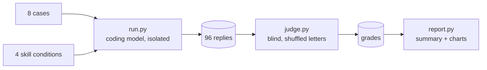

# Evals

A small, reproducible benchmark that checks whether a clean-code skill makes a coding agent produce better changes, and whether it avoids the ways "clean code" advice goes wrong in practice.

## What is measured

Eight coding tasks in [`cases/`](cases). Each has a realistic prompt and five pass/fail assertions. Five of the eight, marked with ●, target situations where applying the book literally makes the result worse:

| Case | What it checks |
|---|---|
| ● Reuse existing helper (Python) | Searches before writing, keeps the diff in scope |
| ● Refactor a function with many callers (TypeScript) | Preserves behavior and the public signature, names magic numbers, no over-engineering |
| ● Clean up hot-path code (Java) | Readability without allocations, virtual calls or helper splitting in a hot loop |
| ● Error handling in Go | Idiomatic `error` values instead of exception-style patterns |
| ● Nullability in Kotlin | Keeps `T?` instead of forcing "never return null" |
| Review a pull request (Python) | Finds the real bugs first, orders findings by impact |
| Follow codebase conventions (C#) | Keeps the `I` prefix and existing patterns |
| Minimal bugfix with regression test (JavaScript) | Root-cause fix, test, minimal diff |

## Conditions

| Name | Skill text in the system prompt |
|---|---|
| `baseline` | none |
| `sickn33` | [`sickn33/agentic-awesome-skills` → `skills/clean-code/SKILL.md`](https://github.com/sickn33/agentic-awesome-skills/blob/bbfc66fe61e8b6ced7d38481c47600e8ac9b8eea/skills/clean-code/SKILL.md), pinned to a commit; the most installed clean-code skill on skills.sh |
| `v1` | the first, German version of this skill ([`skills/v1.md`](skills/v1.md); stored without the `SKILL.md` name so installers do not pick it up) |
| `v2` | the second release, frozen in [`skills/v2.md`](skills/v2.md) so that later releases do not change what these results measured |

Only `SKILL.md` is injected, never the reference files. That holds every condition to the same budget and is conservative for this repo, whose references carry extra material.

## How it runs



- **Isolation.** Each reply comes from a fresh `claude -p` process in an empty temp directory with no tools, no MCP servers, no slash commands, no user or local settings and `CLAUDE_CODE_DISABLE_CLAUDE_MDS=1`, so the user's own setup cannot leak in.
- **Models.** The published run used the aliases `sonnet` (coding) and `opus` (judge), which resolved to `claude-sonnet-5-5` and `claude-opus-5-5` on 2026-11-02. New runs record the exact model IDs in each `runs/*.json`.
- **Blind grading.** For each case and repetition, one judge call sees all four replies under shuffled letters (`A`–`D`) and grades every assertion plus an overall 1–10 quality score. The mapping back to conditions is stored in the grade file.
- **Repetitions.** Three runs per case and condition, because single runs of a language model are noisy.

## Reproduce

Requires Python 3.10+ and a logged-in [Claude Code](https://docs.claude.com/en/docs/claude-code) CLI.

```bash
python evals/run.py --reps 3 --model sonnet   # 96 coding runs
python evals/judge.py --model opus            # 24 blind judge calls
python evals/report.py                        # summary.md + docs/assets/results-*.svg
```

All three scripts skip work that already exists, so delete `evals/results/` to start fresh.

## Limits

- An LLM judge is not a human reviewer. Assertions are written to be checkable from the answer alone, and every verdict stores its evidence in `results/grades/` so you can audit it.
- The grading is only partly blind. Answers written with this repo's skills often cite heuristic codes such as `G25`, and some answers mention "the skill", so the judge can guess which answers had a skill. Answer length is not controlled either: v2 answers are about 40 % longer than baseline answers.
- Eight cases are a small sample. They were written together with v2 of the skill, so v2 has a home advantage on what the cases test. The other conditions are graded on exactly the same criteria.
- Replies are single-turn and tool-free. Real agent sessions read files and run tests; the agentic track below covers that.

## Agentic track

A single reply cannot show the habits that matter most in an agent: searching the codebase, running the tests, adding a regression test, keeping the diff small. The agentic track gives the agent real tools in a throwaway copy of a small repository and grades what it actually did.

Cases live in two splits. `dev` cases may shape the skill; `test` cases are held out. They were written by separate agents that saw neither the skill nor these cases, against one standard: what a strict senior reviewer would accept. A skill change counts only if it also holds up on `test`.

| Split | Case | What it checks |
|---|---|---|
| dev | Feature that needs helpers from other modules (Python) | Finds `format_eur` and `gross_total` elsewhere (a reimplementation gets the per-line VAT rounding wrong), leaves the messy legacy file alone, adds a test |
| dev | Bugfix in a legacy module with a sibling bug (Python) | Root-cause fix, a regression test that fails on the old code, the sibling bug fixed or reported, no drive-by cleanup |
| dev | Refactor untested code with many callers (TypeScript) | Behavior preserved, callers still type-check, `any` replaced, constants named, characterization tests that pass on the old code |
| test | Split an expense by percentage (Python) | Reuses the cent-exact allocation helper, rejects invalid input without saving, updates README and tests |
| test | CSV import fails on blank lines (Python) | Fixes the parser without making it lenient: malformed rows still fail with the right line number |
| test | Remove a deprecated CLI flag (Rust) | Removes alias, help text, dead code (no compiler warnings), tests and README row; adds a changelog entry; keeps shared helpers |
| test | Duration parser switches to milliseconds (TypeScript) | Adapts every caller, including the three that never multiplied and still compile |
| test | Speed up the contact merge (TypeScript) | Linear instead of quadratic while keeping exact old semantics (first match wins, normalized keys, no mutation) |
| test | Split up the checkout function (Python) | Behavior-preserving refactor of a long function whose odd details are deliberate; the neighboring function stays untouched |

- **Runs.** `run_agentic.py` copies `cases-agentic/<split>/<id>/repo/` into a temporary git repository and runs `claude -p` there with Read, Grep, Glob, Edit, Write and Bash, the default Claude Code system prompt and the same isolation flags as above. A skill condition appends the skill to the system prompt and puts its reference files in a directory the agent can read. Each run stores its transcript (without the rate-limit events, which describe the account's quota rather than the run), exact diff, a diff for reading, the final report and metadata in `results/agentic/<model>/runs/`.
- **Deterministic checks.** `grade_agentic.py` rebuilds the repository from the fixture plus the diff, adds the hidden tests from `hidden/` and runs the case's `checks.py`: hidden tests, which files changed, AST comparisons of code that must stay untouched, the agent's own tests run against the original code (a regression test must fail there, a characterization test must pass), and whether the transcript shows a successful test run after the last edit. Every check stores its evidence.
- **Case self-test.** Every case ships a `reference/` solution. `selftest_agentic.py` grades it (it must pass every check) and the untouched fixture (to show which checks discriminate). It costs nothing; run it after changing a case or `checklib.py`.
- **Pairwise judge.** `judge_pairwise.py` shows the judge the repository, two diffs and two final reports, once in each order, with heuristic codes, skill mentions and reference-file paths removed. It asks which pull request the judge would rather merge and why. `--pairs v3a:v2` judges only the comparisons that matter. A verdict is reused until one of its runs changes.
- **Statistics.** `report_agentic.py` writes `results/agentic/summary.md` per coder model and split, with 95 % bootstrap intervals, deltas against no skill and against v2, `rationales.md` with every verdict's reasons, and the README charts `docs/assets/agentic-*.svg`.
- **Versions.** Skill versions measured only here are listed in `harness.CANDIDATE_CONDITIONS`: `v3a`, released as 3.0.0 (`skills/clean-code/SKILL.md` is `v3a` with the version number bumped), and `v3b`, the same rules condensed to 1,381 words (v2 has 2,104), which the judge also preferred over v2 but which passed fewer checks than v2 with Sonnet. Every version is a frozen copy in `evals/skills/`, and the published single-turn results stay as they are.

```bash
python evals/selftest_agentic.py                                   # free: every case's reference passes
python evals/run_agentic.py --split test --model sonnet --conditions baseline,v2,v3a --reps 3
python evals/grade_agentic.py                                      # free, regrades every run
python evals/judge_pairwise.py --split test --pairs v3a:v2         # judge model: opus
python evals/report_agentic.py
```

The TypeScript cases need Node.js (the first run installs TypeScript and `@types/node` into `evals/.cache/node`), the Rust case needs cargo.

Limits:

- Nine cases with three runs per cell. The intervals resample runs within each case, so they describe these tasks, not tasks in general, and with three runs per cell they are optimistic.
- The agent runs with `--permission-mode dontAsk` and unrestricted Bash in a temporary directory. Environment variables whose names look like secrets (`*_TOKEN`, `*_API_KEY`, `*_SECRET`, …) are removed first, but the agent still has your user account, network access and read access outside the workspace. Run larger studies in a container or VM.
- The skill is appended to the system prompt rather than loaded through the Skill tool, so whether the skill triggers is not tested.
- Some checks encode a judgment call (for example `any_replaced` in the dev refactor, the 30-line limit in the checkout refactor, the changelog entry in the flag removal). Each one is justified by the prompt or the repository, and the pairwise judge is the counterweight.
